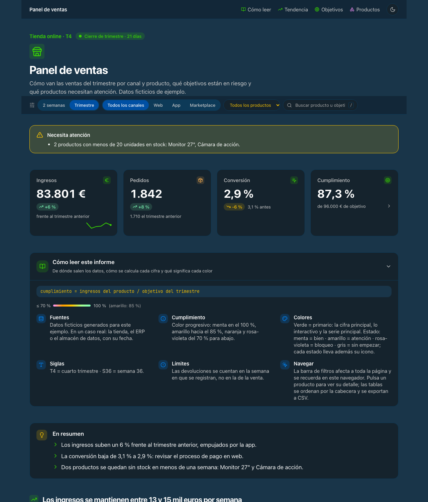
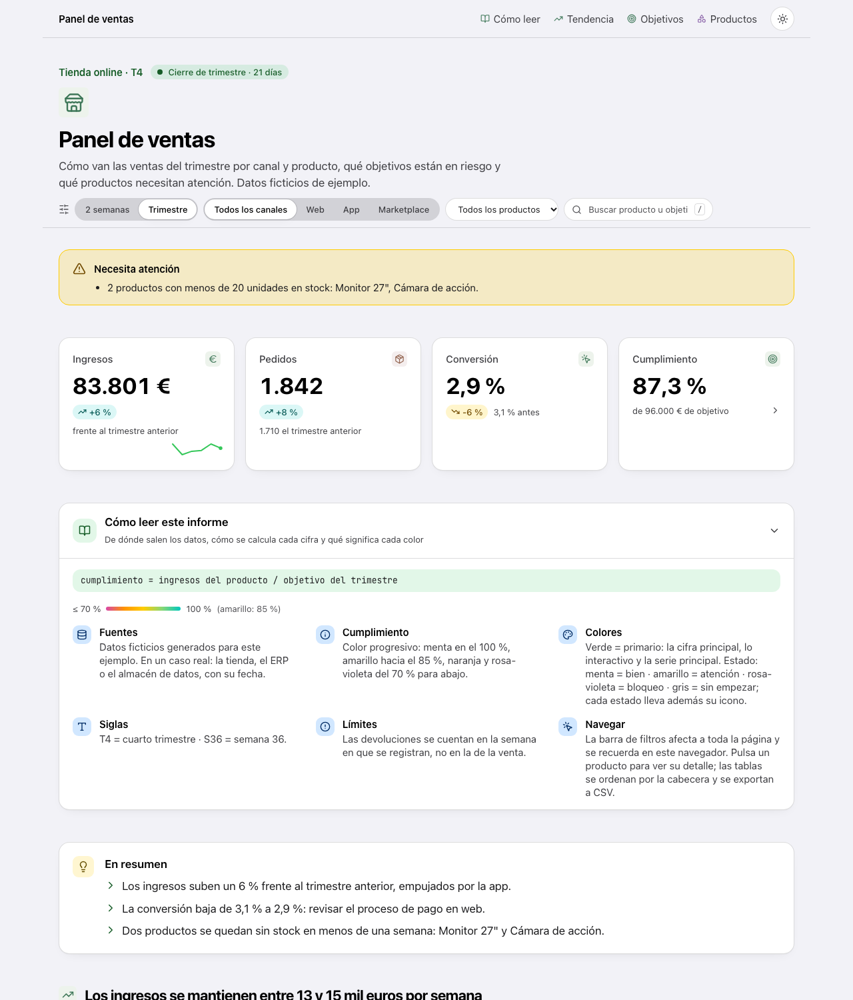
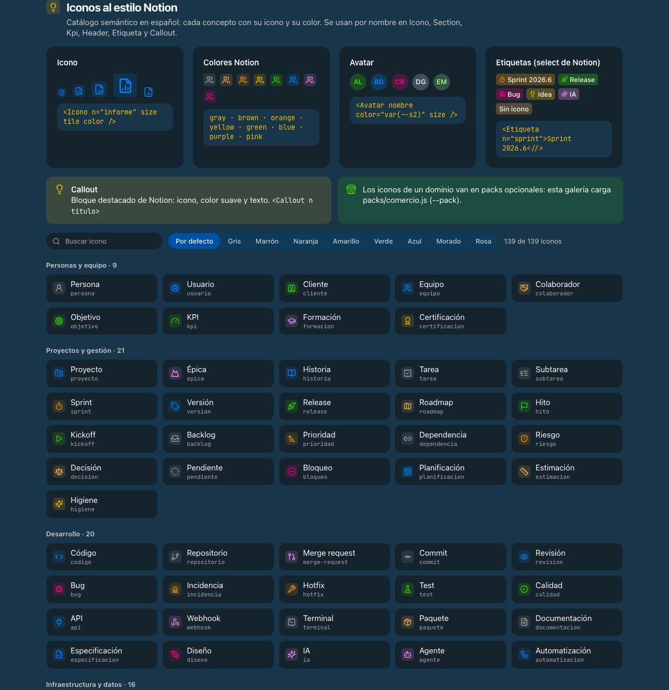

# ArtefactUI

**El design system para dashboards que genera la IA.**

ArtefactUI convierte un prompt y unos datos en un dashboard operativo, coherente y accesible, en un
único fichero HTML listo para publicar como artifact de claude.ai o abrir en cualquier navegador.
Lo usa Claude (como plugin de Claude Code) o cualquiera desde la línea de comandos.



> *Artefact* es la grafía británica de *artifact*: el guiño a los artifacts de Claude y a los
> «artefactos» en español. Si lo buscas como *artifactui*, estás en el sitio correcto.

---

## Qué trae

- **Kit de componentes** en React + Tailwind + Recharts + lucide, escrito con `htm` (sin Babel ni
  `eval`): cabecera, filtros globales que se recuerdan, KPI con variación y minigráfica, gráficas,
  listas agrupadas, tablas ordenables con búsqueda y exportación a CSV, hojas de detalle, estados de
  vacío, carga y error, avisos de calidad de datos y notificaciones.
- **Design system con criterio**: modo oscuro por defecto con la paleta exacta de
  [Cobalt2](https://github.com/wesbos/cobalt2-vscode), modo claro con la paleta de Apple, reglas de
  las [Human Interface Guidelines](https://developer.apple.com/design/human-interface-guidelines/)
  (tipografía, contraste, accesibilidad, movimiento), escala semáforo progresiva **sin rojo**,
  leyendas siempre visibles y una guía obligatoria «Cómo leer este informe».
- **117 iconos al estilo Notion**, por nombre y en español (`<Icono n="informe" />`), con colores
  por tema y **packs** de dominio ampliables.
- **`montar.py`**: junta datos + composición + kit en un único HTML y valida título, iconos, claves
  del catálogo, sintaxis y colores sueltos.
- **`probar.py`**: prueba de interacción en Chrome sin interfaz (filtros, búsqueda, orden, hoja de
  detalle, tema…).
- **Plugin de Claude Code** con la skill `artefactui`, para que Claude aplique todo esto sin que
  tengas que explicárselo.

| Oscuro (Cobalt2) | Claro (Apple) |
|---|---|
|  |  |



---

## Empezar

### Con Claude Code (recomendado)

```text
/plugin marketplace add mrompo/ArtefactUI
/plugin install artefactui@artefactui
```

Después basta con pedirlo: *«hazme un dashboard de las ventas del trimestre con estos datos»*. Claude
carga la skill `artefactui`, escribe `datos.json` y `app.js`, monta la página, la prueba y la
publica como artifact.

### A mano

Necesitas Python 3 y, para validar la sintaxis y probar, Node y Chrome (o Chromium).

```bash
git clone https://github.com/mrompo/ArtefactUI && cd ArtefactUI
python3 kit/montar.py --app ejemplos/tienda/app.js --datos ejemplos/tienda/datos.json --pack packs/comercio.js --salida dist/tienda.html
python3 kit/probar.py dist/tienda.html
open dist/tienda.html           # o dist/galeria.html para ver todos los componentes
```

Un dashboard son dos ficheros tuyos:

- **`datos.json`** con al menos `titulo` (2–4 palabras) y `fecha`, más lo que quieras mostrar.
- **`app.js`** con `function App(){ … }`, que compone la página con los componentes del kit.

```js
function App(){
  const theme = useTheme(), filtros = useFiltros({periodo: 'total'});
  return html`<div className="mx-auto max-w-6xl px-4 pb-10 sm:px-6">
    <${Header} theme=${theme} icono="informe" eyebrow="Ventas · T4" title=${D.titulo} lede="…" estado="Cierre de trimestre · 21 días" links=${[]} />
    <${BarraFiltros} filtros=${filtros} periodos=${[['7d', '2 semanas'], ['total', 'Total']]} />
    <main className="mt-8 flex flex-col gap-12">
      <${Kpi} label="Ingresos" value=${48920} suf=" €" delta=${6} icon="euro" hint="frente al trimestre anterior" />
      <${Guia} formula="cumplimiento = ingresos / objetivo" defs=${[['Fuentes', 'Tienda online, del 1-jul al 30-sep.']]} />
    </main>
    <${Footer} fuentes=${D.fuentes} fecha=${D.fecha} />
  </div>`;
}
```

Parte de [`ejemplos/tienda/app.js`](ejemplos/tienda/app.js) (ventas de una tienda online con datos
ficticios), que ya cumple todo lo que se espera de un dashboard operativo.

### Opciones de `montar.py`

| Opción | Para qué |
|---|---|
| `--pack packs/comercio.js` | añade iconos de un dominio al catálogo (repetible) |
| `--cdn 1.0.0` | carga el kit desde npm vía jsDelivr en vez de incrustarlo (requiere el paquete publicado) |
| `--titulo "…"` | título si no va en los datos |

---

## Componentes

| Grupo | Componentes |
|---|---|
| Página | `Header`, `Footer`, `Section`, `Card`, `Grouped`, `Reveal` |
| Filtros | `useFiltros`, `BarraFiltros` (grupos y elementos), `Buscador`, `Desplegable`, `Segmented`, `visible`, `coincide`, `useRecordado` |
| Cifras | `Kpi`, `Count`, `Spark`, `Anillo`, `Bar`, `Stack` |
| Gráficas | `ChartCard`, `Tip`, `ejes`, `useTokens` (Recharts con los colores del tema) |
| Detalle | `Hoja` (con anterior / siguiente), `useNavegacion`, `Datos`, `Relacionados` |
| Tablas | `SortTable` (con `activa` y `nav`: ↑ ↓ recorren los detalles), `BotonExportar`, `toCSV` |
| Color | `Pill`, `SemPill`, `Leyenda`, `IconBadge`, `Avatar`, `escala`, `semaforo`, `SERIES` |
| Iconos | `ICONOS`, `Icono`, `IconoPagina`, `Etiqueta`, `Callout`, `CatalogoIconos` |
| Lectura | `Guia`, `Resumen`, `Avisos` |
| Estados | `Vacio`, `Esqueleto`, `Protegido`, `validar`, `toast` |
| Edición | `Campo`, `useCompartido` |
| Tema | `useTheme`, `ThemeToggle` |

La referencia completa, con las reglas de diseño, está en
[`skills/artefactui/SKILL.md`](skills/artefactui/SKILL.md). El catálogo visual, en
[`dist/galeria.html`](dist/galeria.html).

## Principios

1. **Primero lo que importa**: 3–4 KPI, la tendencia, lo que está en riesgo y, al final, el detalle.
2. **Títulos que dicen la conclusión**, calculada con los datos.
3. **Nunca solo color**: cada estado lleva icono o texto; toda escala, su leyenda a la vista.
4. **Sin rojo**: el peligro es rosa-violeta; lo que no ha empezado, gris.
5. **Contraste medido**: ≥ 4,5:1 en texto (7:1 en texto pequeño en claro), ≥ 3:1 en rellenos.
6. **Movimiento con propósito**: breve, interrumpible y desactivado con «Reducir movimiento».
7. **Un solo HTML**, sin servidor ni build: se abre, se publica o se adjunta tal cual.

---

## English summary

ArtefactUI is a design system for AI-generated dashboards (built for Claude Code and claude.ai
Artifacts). It ships a React + Tailwind + Recharts + lucide component kit written with `htm`, a
dark-first theme using the exact Cobalt2 palette (Apple's palette in light mode), Apple HIG-based
rules, 117 Notion-style icons, and two scripts: `montar.py` (bundles data + composition + kit into a
single validated HTML file) and `probar.py` (headless interaction test). Install it as a Claude Code
plugin with `/plugin marketplace add mrompo/ArtefactUI`. Component names and docs are in Spanish.

---

## Créditos

- Paleta oscura: [Cobalt2](https://github.com/wesbos/cobalt2-vscode) de Wes Bos (MIT).
- Principios de diseño inspirados en las Human Interface Guidelines de Apple, y estilo de iconos y
  etiquetas inspirado en Notion. ArtefactUI no está afiliado a Apple, Notion ni Anthropic.
- Librerías: [React](https://react.dev) (MIT), [Tailwind CSS](https://tailwindcss.com) (MIT),
  [Recharts](https://recharts.org) (MIT), [lucide](https://lucide.dev) (ISC),
  [htm](https://github.com/developit/htm) (Apache-2.0).

## Licencia

[MIT](LICENSE) © 2026 Manuel Romero
